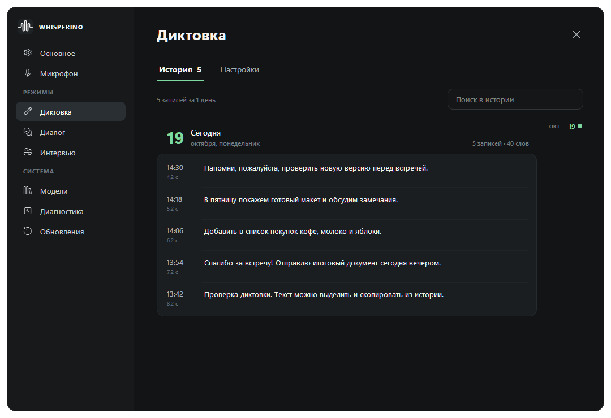
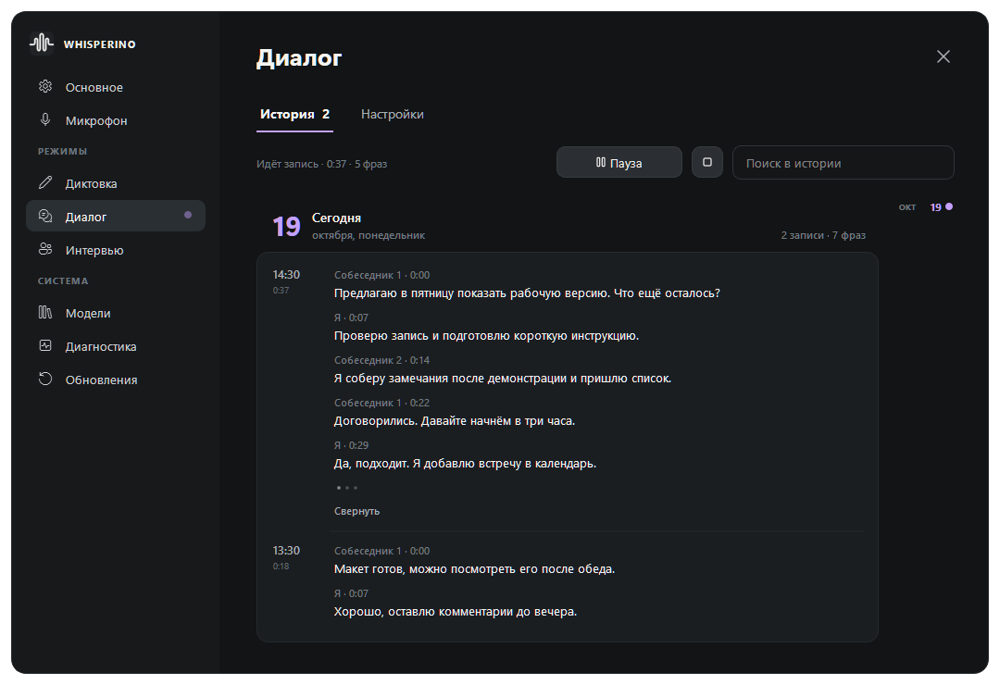

# Whisperino

Portable-программа для Windows: распознаёт речь локально, записывает разговоры и помогает находить нужные места в Markdown-базе знаний.

[Скачать portable ZIP](https://github.com/ZuwerTeam/whisperino-releases/releases/latest/download/Whisperino-stable-Portable.zip) · [Все версии и изменения](https://github.com/ZuwerTeam/whisperino-releases/releases)

## Диктовка

Удерживайте `Ctrl + Win` и говорите. После отпускания клавиш текст попадёт в историю, буфер обмена и активное окно. Доставку текста можно настроить.

## Диалог

Удерживайте Ctrl и дважды нажмите Win, чтобы начать или закончить запись разговора. На странице «Диалог» также есть начало, пауза и остановка. Сочетания меняются в настройках.

Программа слушает микрофон и весь звук компьютера. Фразы появляются по мере распознавания, их можно копировать и сохранять в TXT или Markdown ещё до окончания записи. Чтобы продиктовать сообщение во время разговора, удерживайте `Ctrl + Win`. Диалог при этом продолжается.

Определение собеседников работает локально, модель входит в сборку. Подписи голосов пока экспериментальные: номера могут меняться в длинном разговоре. Одновременно звучащие голоса не всегда удаётся распознать раздельно. Ваш микрофон подписывается «Я».

## Интервью

Непрерывное распознавание речи с поиском подходящих фрагментов в выбранной Markdown-базе знаний. Источник звука и документы выбираются в настройках режима.

## Первый запуск

1. Скачайте ZIP и распакуйте в отдельную папку, где у вас есть право записи.
2. Запустите `Whisperino.exe` из корня portable-папки. Установщик и отдельная установка Python не нужны.
3. Выберите микрофон и горячую клавишу в настройках.

Распознавание работает офлайн. Настройки, история и скачанные модели остаются в portable-папке. Чтобы перенести программу, закройте её и скопируйте всю папку.

## Обновления

Откройте настройки обновлений. Программа покажет установленную и новую версии, изменения, ход загрузки и скорость. Нажмите кнопку обновления: программа скачает пакет, проверит его, сохранит данные и перезапустится.

Можно включить автоматическую проверку при запуске. Новая версия скачивается только после нажатия кнопки. Если идёт запись или распознавание, завершите их перед обновлением.

Этот репозиторий содержит готовые сборки. Для работы программы и получения обновлений аккаунт GitHub не требуется.
