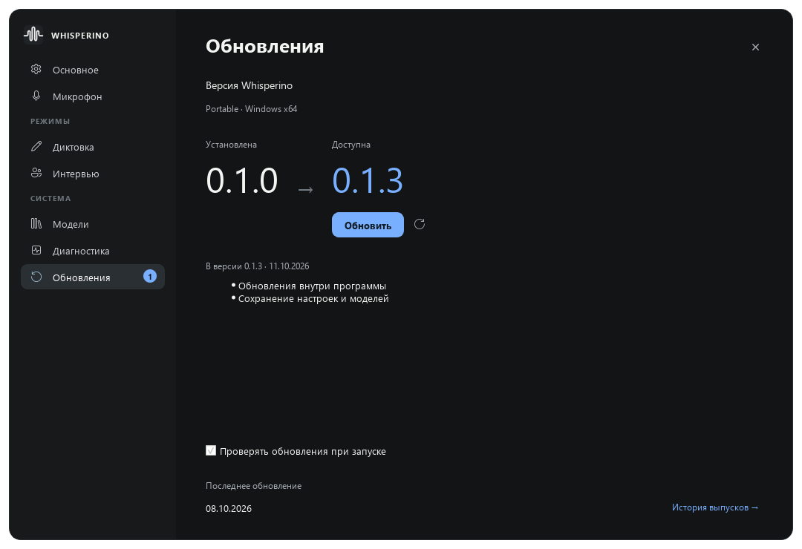

# Whisperino

Portable-программа для Windows: распознаёт речь локально, помогает диктовать текст и находить нужные места в базе знаний во время разговора.

[Скачать portable ZIP](https://github.com/ZuwerTeam/whisperino-releases/releases/latest/download/Whisperino-stable-Portable.zip) · [Все версии и изменения](https://github.com/ZuwerTeam/whisperino-releases/releases)

## Первый запуск

1. Скачайте ZIP и распакуйте в отдельную папку, где у вас есть право записи.
2. Запустите `Whisperino.exe` из корня portable-папки. Установщик и отдельная установка Python не нужны.
3. Выберите микрофон и горячую клавишу в настройках.

Распознавание работает офлайн. Настройки, история и скачанные модели остаются в portable-папке. Чтобы перенести программу, закройте её и скопируйте всю папку.

## Обновления

Откройте настройки обновлений. Программа покажет установленную и новую версии, изменения, ход загрузки и скорость. Нажмите кнопку обновления: программа скачает пакет, проверит его, сохранит данные и перезапустится.

Можно включить автоматическую проверку при запуске. Новая версия скачивается только после нажатия кнопки. Если идёт запись или распознавание, завершите их перед обновлением.

Этот репозиторий содержит готовые сборки. Для работы программы и получения обновлений аккаунт GitHub не требуется.
